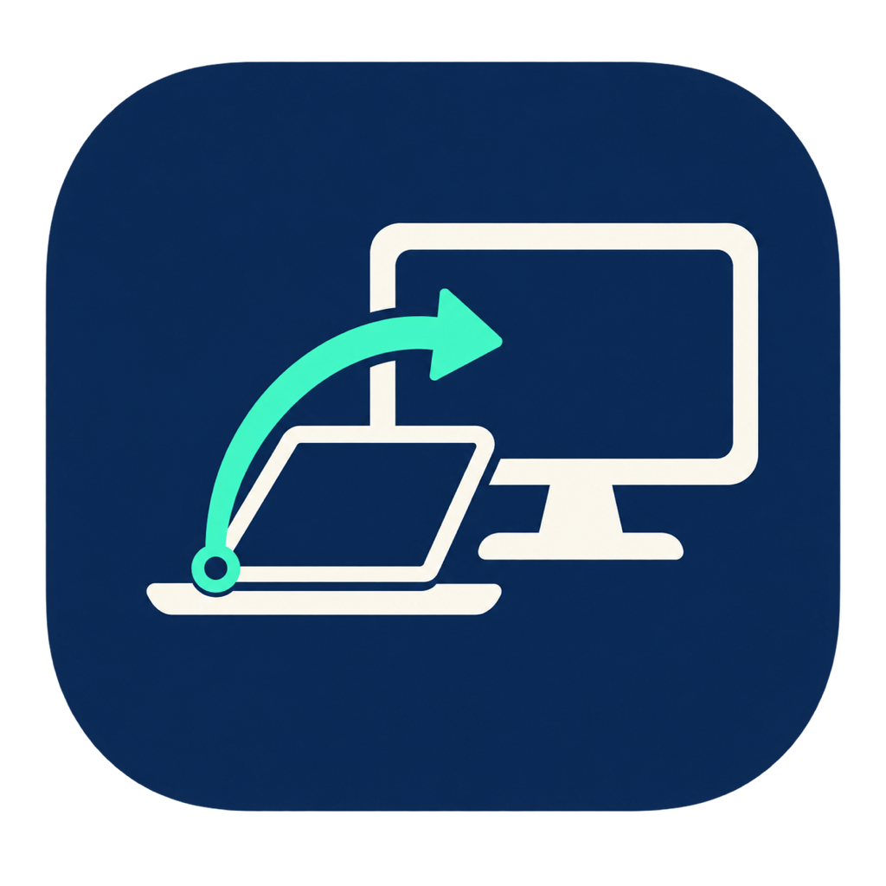

<p align="center">
  
</p>

<h1 align="center">LidSwitch</h1>

<p align="center">
  开盖只用 MacBook 内屏，合盖只用外接显示器。<br>
  A tiny macOS menu bar utility for automatic lid-aware display switching.
</p>

<p align="center">
  <a href="https://github.com/Chiuvenz/LidSwitch/actions/workflows/ci.yml"></a>
  
  
  <a href="LICENSE"></a>
</p>

LidSwitch 是一个轻量级原生 macOS 菜单栏应用，为经常在 MacBook 和外接显示器之间切换的用户补上系统缺少的自动化：

| MacBook 状态 | 内建显示器 | 外接显示器 |
| --- | --- | --- |
| 开盖 | 启用 | 从桌面布局中停用 |
| 合盖 | 由 macOS 合盖模式关闭 | 启用 |

它执行真正的逻辑显示器切换，不是单纯把亮度调到零，因此鼠标和窗口不会跑到已经停用的屏幕。

## 功能

- 自动监听 MacBook 开盖、合盖、睡眠、唤醒和显示器配置变化。
- 开盖时先确认内屏可用，再关闭外屏，避免无画面状态。
- 合盖时重新启用外屏，然后交给 macOS 原生合盖模式管理内屏。
- 支持多个可识别的外接显示器。
- 拒绝关闭最后一个活动显示器。
- 提供“恢复所有显示器”紧急恢复入口。
- 支持登录时启动。
- 不需要管理员权限，不安装内核扩展，不收集遥测数据。

## 系统要求

- Apple Silicon MacBook Air 或 MacBook Pro。
- macOS 14 Sonoma 或更新版本。
- 普通 HDMI、DisplayPort 或 USB-C 外接显示器。
- 合盖使用时需要满足 macOS 合盖模式条件，例如接通电源并准备外接键盘和鼠标。

目前已在以下环境完成实机接口验证：

- M5 MacBook Air (`Mac17,3`)
- macOS 26.5.2
- Redmi 27 NU，USB-C DisplayPort 连接

Intel Mac、DisplayLink、AirPlay、Sidecar 和虚拟显示器尚未支持或验证。通过特殊扩展坞连接、且不向系统报告有效厂商或型号的显示器会被安全忽略。

## 从源码运行

需要安装 Xcode Command Line Tools：

```sh
git clone https://github.com/Chiuvenz/LidSwitch.git
cd LidSwitch
make test
make run
```

构建出的应用位于 `dist/LidSwitch.app`。长期使用时，建议先退出测试实例，再把它移动到 `/Applications` 并重新打开。

只读诊断：

```sh
dist/LidSwitch.app/Contents/MacOS/LidSwitch --diagnose
```

## 使用方法

1. 打开 LidSwitch，菜单栏会出现双显示器图标。
2. 点击“自动切换”。
3. 开盖和合盖各测试一次。
4. 确认正常后，可开启“登录时启动”。

首次运行时自动切换默认关闭。如果遇到异常，选择“恢复所有显示器”；极端情况下可以拔插显示器线缆或重新登录。

## 安全设计

每次切换都先读取真实显示器状态，再计算下一步操作。开盖时必须先观察到内屏已经 active，才允许停用外屏。底层还会独立检查操作后至少保留一个活动显示器。

显示配置优先使用 app-lifetime 提交，系统不接受时才回退到当前登录会话；关闭自动切换或正常退出时会主动恢复可识别的显示器。

## 实现与限制

LidSwitch 使用 Swift、AppKit、IOKit 与 CoreGraphics，并动态调用未公开的 SkyLight 显示拓扑接口。它不链接私有框架，也不需要特殊系统权限，但仍存在以下限制：

- 不适合提交到 Mac App Store。
- macOS 大版本升级后，私有接口可能需要重新适配。
- 被 `SIGKILL` 强制结束时，session 级配置可能来不及恢复。
- 当前版本会统一控制所有可识别外屏，暂不提供显示器白名单。

技术可行性记录见 [docs/FEASIBILITY.md](docs/FEASIBILITY.md)。

## 隐私

LidSwitch 完全在本机运行，不联网，不上传显示器信息，不包含分析或遥测代码。设置仅通过 macOS `UserDefaults` 保存在本机。

## 开源协议

项目使用 [MIT License](LICENSE)。显示拓扑实现方式参考并独立核对了 MIT-licensed [Clamless](https://github.com/TCXM/clamless) 项目。

欢迎提交 Issue 和 Pull Request。
