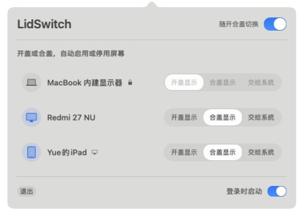

<p align="center">
  
</p>

<h1 align="center">LidSwitch</h1>

<p align="center">
  开盖、合盖，各有一组顺手的屏幕。<br>
  A tiny macOS menu bar utility for automatic lid-aware display switching.
</p>

<p align="center">
  <a href="https://github.com/Chiuvenz/LidSwitch/actions/workflows/ci.yml"></a>
  
  
  <a href="LICENSE"></a>
</p>

LidSwitch 是一个轻量级原生 macOS 菜单栏应用，为经常在 MacBook 和外接显示器之间切换的用户补上系统缺少的自动化：

| 屏幕显示规则 | 开盖时 | 合盖时 |
| --- | --- | --- |
| 开盖显示 | 启用 | 目标屏幕可用后停用；内建屏由 macOS 合盖模式关闭 |
| 合盖显示 | 开盖时的屏幕可用后停用 | 启用 |
| 交给系统 | 由 macOS 管理 | 由 macOS 管理 |

适用场景：办公桌上放置一个固定小桌面，坐下时使用外接屏幕，站起时使用MacBook，屏幕鼠标键盘跟随，隐私有保护。

<p align="center">
  
</p>

## 功能

- 自动监听 MacBook 开盖、合盖、睡眠、唤醒和显示器配置变化。
- 原生半透明面板使用单行设备名称与轻巧的胶囊式显示规则选择。
- 图标蓝色表示正在显示，灰色表示未显示；随航设备带有小标记，详细状态可悬停查看。
- MacBook 内建显示器固定为“开盖显示”；其他显示器可各自选择“开盖显示”“合盖显示”或“交给系统”。
- 新接入的外屏默认“交给系统”，不主动修改。
- 只有内建屏和至少一块额外屏幕可用时才允许自动切换；屏幕不足时暂停并置灰开关，重新连接后按原开关状态恢复。
- 改为“交给系统”时，先恢复 LidSwitch 停用的该设备，其他设备的规则不变。
- 先启用并确认目标组屏幕可用，再停用另一组，避免无画面状态。
- 合盖组没有可用的普通外屏时保留当前显示器，不强行执行全灭；不阻止系统睡眠。
- 过滤 macOS/SkyLight 遗留的离线幽灵显示器记录。
- 实验性支持一台随航 iPad，独立管理会话，不直接开关虚拟显示器。
- 拒绝关闭最后一个活动显示器。
- 关闭“随开合盖切换”时恢复 LidSwitch 停用的显示器。
- 支持登录时启动。
- 不需要管理员权限，不安装内核扩展，不收集遥测数据。

## 系统要求

- Apple Silicon MacBook Air 或 MacBook Pro。
- macOS 14 Sonoma 或更新版本。
- 普通 HDMI、DisplayPort 或 USB-C 外接显示器。
- 合盖使用时需要满足 macOS 合盖模式条件，例如接通电源并准备外接键盘和鼠标。

目前已在以下环境完成实机接口验证：

- M5 MacBook Air (`Mac17,3`)
- macOS 26.5.2、27.0.1
- Redmi 27 NU，USB-C DisplayPort 连接

Intel Mac、DisplayLink、普通 AirPlay 接收屏和其他虚拟显示器尚未支持或验证。iPad 随航提供实验性支持，限制见下文。通过特殊扩展坞连接、且不向系统报告有效厂商或型号的显示器会被安全忽略。

## 从源码运行

需要安装 Xcode Command Line Tools：

```sh
git clone https://github.com/Chiuvenz/LidSwitch.git
cd LidSwitch
make test
make run
```

构建出的应用位于 `dist/LidSwitch.app`。

只读诊断：

```sh
dist/LidSwitch.app/Contents/MacOS/LidSwitch --diagnose
```

## 使用方法

1. 打开 LidSwitch，菜单栏会出现双显示器图标。
2. “MacBook 内建显示器”固定为“开盖显示”，小锁表示不可更改。
3. 在其他设备右侧选择“开盖显示”“合盖显示”或“交给系统”，多块屏幕可以使用相同规则。
4. 开启“随开合盖切换”，然后开盖和合盖各测试一次。
5. 确认正常后，可开启“登录时启动”。

胶囊选择表示“在哪种状态下显示”，左侧图标颜色表示“当前是否正在显示”，两者互相独立。例如，将内建屏和 iPad 设为“开盖显示”、桌面显示器设为“合盖显示”：开盖使用内屏与 iPad，合盖使用桌面显示器。每台外屏只能选择一种规则，也可以选择“交给系统”，不由 LidSwitch 控制。

未连接的受控设备仍保留在列表中，可以修改规则或改为“交给系统”。关闭自动切换时也可以编辑规则，重新开启后生效。升级前已勾选的外屏自动迁移为“合盖显示”，其他设备仍交给系统。

首次运行时自动切换默认关闭。如果遇到异常，关闭顶部“随开合盖切换”即可恢复 LidSwitch 停用的显示器；极端情况下可以拔插显示器线缆或重新登录。

### 屏幕不足时自动暂停

只有确认内建屏与至少一块额外屏幕可用时，才允许启用自动切换。仅剩内建屏时，开关显示为关闭且不可操作，悬停可查看暂停原因；原来的开关意图和显示规则仍保留，规则也可以继续编辑。

重新连接后，原本开启的自动切换会恢复，原本关闭的不会被擅自开启。“可用”不等于“正在亮屏”：LidSwitch 主动停用但仍连接的物理屏幕，仍会通过连接信息计入；离线幽灵记录和仅保存在设置中的 iPad 不计入。连接信息无法确认时会保守暂停。随航的合盖使用限制仍然适用。

显示器状态通过系统事件更新，不新增定时轮询。这个启用门槛与“先启用目标组”和“最后一屏保护”同时生效，不替代其他安全检查。

### 实验性 iPad 随航

先通过 macOS“屏幕镜像”成功连接一次 iPad，再在 LidSwitch 中为它选择显示规则。列表用小图标标记随航设备，悬停可查看实验性标识和会话状态，目前只允许控制一台 iPad。

- 选择“开盖显示”：内屏就绪后连接随航；合盖后先恢复普通外屏，再断开随航。
- 选择“合盖显示”：开盖且内屏就绪后断开随航；合盖且普通外屏就绪后尝试重连。
- 断开意味着 iPad 返回自身界面，不是锁屏或物理熄屏。
- 合盖时需要一台已启用且不会因“开盖显示”规则停用的普通外屏；不支持只有 iPad 的无头合盖重连，也不会阻止系统睡眠。
- iPad 应保持可用并解锁，且满足 Apple 随航条件。无法连接时最多尝试三次，不影响其他屏幕；确认设备可用后可改为“交给系统”再重新选择显示规则以重试。
- 改为“交给系统”或关闭自动切换，只会尝试恢复 LidSwitch 自己断开的随航会话。正常退出会留出有限的恢复时间，失败时需要在系统中手动重连。

此功能使用未公开的 SidecarCore 接口，系统更新可能使它失效；不等同于对所有隔空播放设备的支持。

## 安全设计

每次切换都先读取真实显示器状态，再计算下一步操作。开盖先启用内屏与开盖组外屏，再停用合盖组；合盖先启用合盖组普通外屏，再停用开盖组外屏。目标组没有可用的普通外屏时，不强行停用当前物理屏幕。不参与的外屏不会进入切换事务，底层还会独立检查操作后至少保留一个活动显示器。

菜单只把 `active` 或 `online` 的外屏列为新候选。被 LidSwitch 主动停用的已选外屏会继续显示并可恢复；其他离线记录会被视为幽灵显示器并忽略。若 macOS 为同一台显示器分配了新的 ID，LidSwitch 会通过硬件信息安全迁移选择。

显示配置优先使用 app-lifetime 提交，系统不接受时才回退到当前登录会话；关闭自动切换或正常退出时会主动恢复可识别的显示器。

## 实现与限制

LidSwitch 使用 Swift、AppKit、IOKit 与 CoreGraphics，并在运行时动态加载未公开的 SkyLight 显示拓扑接口和 SidecarCore 随航会话接口，不需要特殊系统权限，但仍存在以下限制：

- macOS 大版本升级后，私有接口可能需要重新适配。
- 分组只管理启用状态，不保存或强制修改屏幕排列、分辨率和主显示器；普通屏幕停用后是否进入待机取决于屏幕自身。
- 被 `SIGKILL` 强制结束时，session 级配置可能来不及恢复。
- 两台厂商、型号和序列号都完全相同的外屏如果同时更换 ID，可能需要在菜单中重新选择一次。

技术可行性记录见 [docs/FEASIBILITY.md](docs/FEASIBILITY.md)。

## 隐私

LidSwitch 不主动访问互联网，不上传显示器信息，不包含分析或遥测代码。设置仅通过 macOS `UserDefaults` 保存在本机；随航连接由系统负责，可能通过本地无线网络或 USB 与 iPad 通信。

## 开源协议

项目使用 [MIT License](LICENSE)。显示拓扑实现方式参考并独立核对了 MIT-licensed [Clamless](https://github.com/TCXM/clamless) 项目。

随航会话接口参考并独立核对了 [SidecarLauncher](https://github.com/Ocasio-J/SidecarLauncher) 的调用方式。

欢迎提交 Issue 和 Pull Request。
